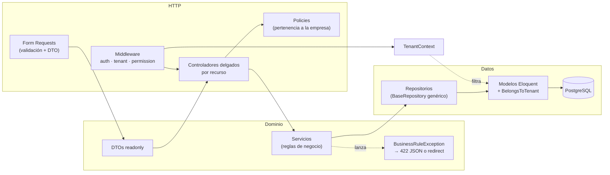
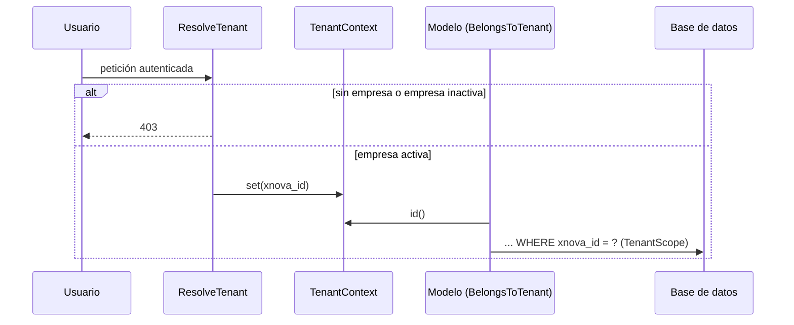

# xNova SaaS

[](https://github.com/Mine25-afk/xnova-saas/actions/workflows/ci.yml)


[](LICENSE)

Plataforma **SaaS multiempresa** para negocios de servicios (clínicas, salones, barberías, catálogos y finanzas personales). Cada empresa —internamente una *xnova*— opera con sus propios datos, usuarios, roles y suscripción, sobre una sola base de datos compartida.

## Índice

- [Módulos](#módulos)
- [Arquitectura](#arquitectura)
- [Aislamiento multiempresa](#aislamiento-multiempresa)
- [Decisiones de diseño](#decisiones-de-diseño)
- [Stack](#stack)
- [Cómo correrlo](#cómo-correrlo)
- [Pruebas y calidad](#pruebas-y-calidad)
- [Estructura del proyecto](#estructura-del-proyecto)
- [Capturas](#capturas)
- [Autores y licencia](#autores-y-licencia)

## Módulos

| Módulo | Qué resuelve |
|---|---|
| **Citas** | Agenda interna con detección de choques por colaborador, validación contra el horario y receso de la sucursal, cálculo de huecos libres, calendario mensual y recordatorios por correo (24 h y 2 h antes). |
| **Reserva pública** | Formulario público por empresa (`/reservar/{uid}`) con acceso por Google o como invitado (límite diario por sesión e IP). |
| **Socios** | Clientes y colaboradores, con registros por defecto y bitácora de cambios. |
| **Sucursales y horarios** | Sucursales con jornada por día y receso. |
| **Seguridad** | Usuarios, roles y permisos propios por pantalla y botón (módulo → pantalla → botón). |
| **Inventario** | Productos con imagen optimizada y reportes. |
| **Finanzas** | Propietarios, cuentas con bolsillos, movimientos, transferencias, deudas, cuentas por cobrar, ingresos/gastos fijos, operaciones pendientes de confirmar, captura rápida y reportes (vista, CSV y PDF). |
| **Suscripciones** | Paquetes con usuarios/sucursales incluidos, prueba gratis con límites y cobro recurrente con PayPal (webhooks). |
| **Superadministración** | Panel transversal con el estado de todas las empresas. |

## Arquitectura

Arquitectura por capas inspirada en el patrón `controller → service → repository` de NestJS, adaptada a Laravel:



- **Controladores**: solo traducen HTTP ↔ dominio. El antiguo `FinanzasController` (2.763 líneas) quedó en 13 controladores por recurso y `CitaController` (886 líneas) en 5.
- **Form Requests**: toda la validación vive ahí y expone el resultado como DTO (`toDto()`), así los servicios no dependen de `Request`.
- **Servicios**: reglas de negocio (`MovimientoService`, `DeudaService`, `AgendaService`, `CitaService`, `ReservaPublicaService`...). La lógica pura —saldos (`SaldoCalculator`) y huecos de agenda (`AgendaService::calcularHuecos`)— no toca la base y se prueba de forma unitaria.
- **Repositorios**: `BaseRepository<TModel>` genérico (CRUD, paginación, transacciones) y repositorios por agregado con las consultas del dominio.
- **Errores de negocio**: los servicios lanzan `BusinessRuleException` sin saber quién los llamó; la excepción decide si responde JSON 422 (AJAX) o redirige con errores (formularios).

## Aislamiento multiempresa

El sistema original filtraba cada consulta a mano con `where('xnova_id', ...)` y, si el usuario no tenía empresa, **caía a "la primera empresa de la base"**, lo que podía mostrar datos de otra empresa. Ahora el aislamiento es estructural:



1. **`TenantContext`** (instancia *scoped*, una por request/job) guarda la empresa activa. Si algo consulta antes del middleware (p. ej. el *route model binding*) usa la empresa del propio usuario autenticado; nunca otra.
2. **`ResolveTenant`** fija la empresa del usuario y responde **403** si no tiene una o está inactiva. **`ResolvePublicTenant`** hace lo mismo para la reserva pública a partir del `uid` de la URL (404 si no existe).
3. **`BelongsToTenant`** (trait de los modelos de empresa):
   - agrega `TenantScope` como *global scope*; **sin tenant resuelto la consulta no devuelve filas** (fail-closed);
   - asigna `xnova_id` automáticamente al crear y lanza excepción si no hay empresa activa;
   - impide crear un registro en otra empresa o cambiarle el `xnova_id`.
4. **Excepciones explícitas y acotadas**: `forTenant($id)` para procesos internos que trabajan con una empresa conocida y `acrossTenants()` para los pocos casos transversales. El comando de recordatorios recorre las empresas y procesa cada una dentro de su propio contexto (`runAs`).
5. **Lo que el scope no cubre** también está resuelto: las reglas `exists/unique` de validación (consultan sin Eloquent) se acotan con `TenantFormRequest`, y `User` —que no puede llevar scope porque la autenticación lo busca antes de conocer la empresa— se protege con `UserPolicy`.
6. **Policies** (`TenantOwnedPolicy`) como segunda línea de defensa: un registro ajeno responde **404** para no revelar que existe.

## Decisiones de diseño

| Decisión | Por qué |
|---|---|
| Global scope *fail-closed* en lugar de filtros manuales | Olvidar un `where` ya no filtra datos de otra empresa: el peor caso es una lista vacía, no una fuga. |
| `TenantContext` *scoped* | Una instancia por request/job: el tenant nunca se arrastra entre peticiones (seguro con Octane y colas). |
| 404 en lugar de 403 para datos ajenos | No confirma la existencia de registros de otras empresas. |
| Controladores por recurso | Cada archivo tiene una responsabilidad; las rutas y nombres de ruta se conservaron para no tocar las vistas. |
| Form Requests + DTOs `readonly` | Validación declarativa y contratos explícitos entre capas; los servicios se prueban sin HTTP. |
| Repositorios sobre Eloquent | Consultas del dominio con nombre (`saldosPorCuenta`, `conflictoDeColaborador`) y puntos de reemplazo para pruebas con Mockery. Los CRUD triviales hablan directo con el repositorio, sin servicio intermedio. |
| `BusinessRuleException` con `render()` | Un mismo servicio sirve a endpoints AJAX y a formularios clásicos sin duplicar manejo de errores. |
| Tailwind 3 + WireUI 2 + Livewire | Las vistas usan el preset de WireUI (Tailwind 3) y más de 250 componentes WireUI; migrar a Tailwind 4 no aportaba valor. |

## Stack

- **Backend**: PHP 8.2+, Laravel 12, Sanctum, Socialite (Google), DomPDF, PayPal (suscripciones y webhooks).
- **Frontend**: Blade, Livewire 4 + WireUI 2, Alpine (vía Livewire), Tailwind CSS 3, Vite 7.
- **Datos**: PostgreSQL 16 (producción) y SQLite en memoria (pruebas).
- **Calidad**: Pest 3, Mockery, Larastan (PHPStan), Laravel Pint.
- **Infraestructura**: Docker (PHP-FPM + Nginx), docker compose, GitHub Actions.

## Cómo correrlo

### Con Docker (recomendado)

```bash
cp .env.example .env
docker compose build
# Genera la clave y pégala en APP_KEY dentro de .env
docker compose run --rm --no-deps --entrypoint php app artisan key:generate --show
docker compose up -d
docker compose exec app php artisan db:seed   # catálogo de permisos, estados y paquetes
```

La aplicación queda en <http://localhost:8080>. Servicios: `app` (PHP-FPM, aplica migraciones al arrancar), `web` (Nginx), `scheduler` (recordatorios de citas), `queue` y `postgres`.

### Local

Requisitos: PHP 8.2+ con `pdo_pgsql`, Composer, Node 22 y PostgreSQL.

```bash
composer install
cp .env.example .env          # ajusta DB_HOST=127.0.0.1 y credenciales
php artisan key:generate
php artisan migrate --seed
npm ci && npm run build
composer dev                  # servidor, cola, logs y Vite en paralelo
```

### Variables relevantes

| Variable | Uso |
|---|---|
| `SUPERADMIN_EMAILS` | Correos (separados por coma) con acceso al panel de superadministración. Vacío = nadie. |
| `GOOGLE_CLIENT_ID` / `GOOGLE_CLIENT_SECRET` | Inicio de sesión y registro con Google. |
| `PAYPAL_*` | Credenciales y planes de PayPal (por defecto sandbox). |

## Pruebas y calidad

```bash
composer test      # Pest sobre SQLite en memoria
composer lint      # Laravel Pint (--test)
composer analyse   # Larastan nivel 5
```

| Suite | Cobertura |
|---|---|
| `tests/Feature/Tenancy` | Un usuario de la empresa A no puede ver, editar ni usar en validaciones datos de la empresa B; usuario sin empresa → 403; empresa inactiva → 403; scope fail-closed; asignación y bloqueo de `xnova_id`. |
| `tests/Feature/Citas` | Alta, choques, confirmación fuera de horario, cambios de estado, huecos libres, reserva pública (invitado, límite diario, horario, productos ajenos) y recordatorios en varias empresas. |
| `tests/Feature/Finanzas` | Cuentas con saldo inicial, ingresos/gastos, transferencias pendientes y confirmadas, abonos a deudas, anulaciones, ajuste de saldo, exportación CSV y permisos. |
| `tests/Unit` | `SaldoCalculator`, cálculo de huecos y helpers de agenda, `CuentaService` con repositorios simulados, `FijoService` y `TenantContext`. |

El workflow de CI ejecuta Pint, Larastan, las pruebas y el build de assets en cada push y pull request.

> Pint y Larastan cubren las capas refactorizadas (tenancy, dominio, HTTP nuevo, modelos y pruebas). Los controladores heredados que solo recibieron cambios mínimos se irán incorporando al migrarlos.

## Estructura del proyecto

```
app/
├── DTOs/                 # Objetos de datos readonly (Finanzas, Citas)
├── Enums/                # EvaluacionHorario
├── Exceptions/           # BusinessRuleException
├── Http/
│   ├── Controllers/
│   │   ├── Citas/        # Agenda, estados, calendario, huecos, reserva pública
│   │   ├── Finanzas/     # Un controlador por recurso
│   │   └── Concerns/
│   ├── Middleware/       # ResolveTenant, ResolvePublicTenant, permisos, superadmin
│   └── Requests/         # Form Requests (TenantFormRequest como base)
├── Models/               # Eloquent; los de empresa usan BelongsToTenant
├── Policies/             # TenantOwnedPolicy y derivadas
├── Repositories/         # BaseRepository + repositorios por agregado
├── Services/             # Reglas de negocio (Finanzas, Citas, suscripciones...)
├── Support/
└── Tenancy/              # TenantContext, TenantScope, BelongsToTenant
routes/
├── web.php               # Grupos: público, superadmin, auth, auth + tenant
├── citas.php
└── finanzas.php
tests/
├── Feature/              # Tenancy, Citas, Finanzas
├── Unit/
└── Support/Escenario.php # Arma una empresa completa para pruebas
docker/                   # Nginx, php.ini y entrypoint
```

## Capturas

> _Pendiente (opcional)_: agregar capturas del dashboard financiero, la agenda de citas y la reserva pública en `docs/capturas/`.

## Autores y licencia

Desarrollado por **Eduardo Varela** y **Alejandra Solis**. Distribuido bajo licencia [MIT](LICENSE).
